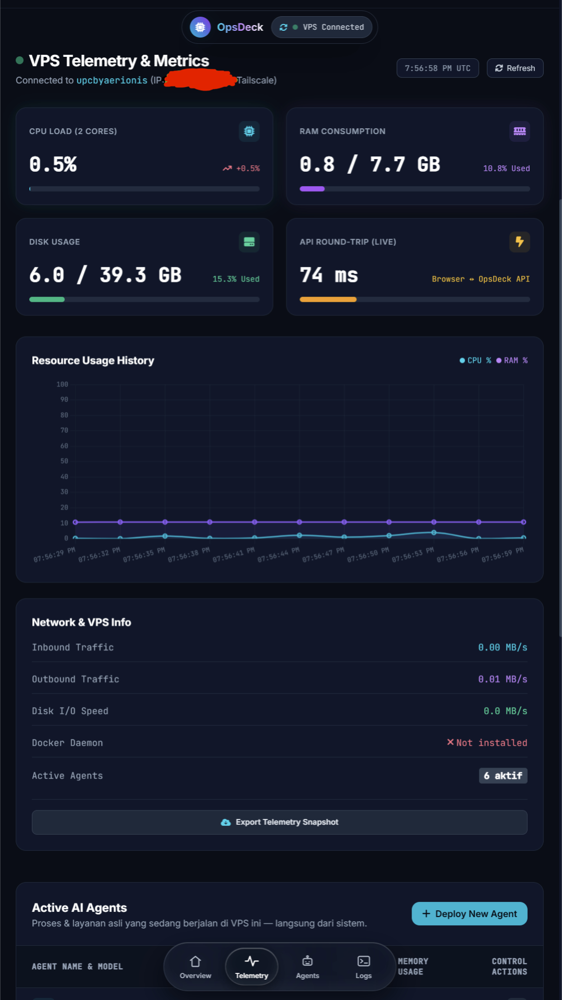
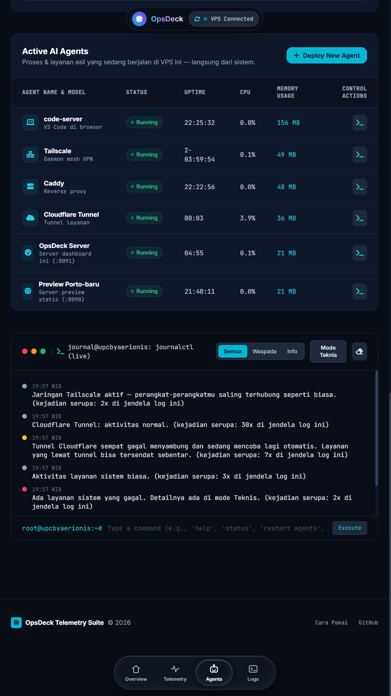

# OpsDeck

English | [Bahasa Indonesia](README.id.md)

A web dashboard that watches your VPS from a single screen: native telemetry (CPU, RAM, disk, network), a list of running processes, and system logs straight from the journal, in two view modes: **Technical** and **Plain**.

Everything shown is **read directly from the server** and refreshes automatically. No simulated data.



## Features

- **Real-time telemetry** - CPU, RAM, disk, network & disk I/O rates, read from `/proc` and refreshed every 3 seconds, with history graphs.
- **Real process list** - the services actually running on the server (code-server, Caddy, Tailscale, opencode during builds, etc.) with uptime, CPU, and memory.
- **Two-mode logs** - Technical mode shows the raw journal. Plain mode translates it into color-coded everyday sentences (good / normal / warning / failing) using **fixed rules on the server: no AI, no tokens**.
- **Dynamic identity** - the server name and Tailscale IP are picked up automatically from the machine; no address is written into the HTML by hand.
- **Tailscale only** - the server listens on the Tailscale interface alone, so this page is not reachable from the public internet.
- **How-to page** - a plain-language guide at `panduan.html`.



## Running

Requirements: Linux with systemd (`journalctl`), Python 3 (standard library only), and an active Tailscale.

```bash
python3 server.py
```

The server detects this machine's Tailscale IP automatically, then serves the dashboard on port `8091`. Open it from any device joined to the same tailnet:

```
http://<ip-tailscale-server>:8091
```

## API

| Endpoint | Contents |
|---|---|
| `GET /api/stats` | Hostname, Tailscale IP, CPU, RAM, disk, network & disk rates, load, uptime, Docker status |
| `GET /api/agents` | Running process groups with uptime, CPU, and memory |
| `GET /api/logs` | Last 45 lines of `journalctl` |
| `GET /api/feed` | The same logs, translated by fixed rules into everyday-language events (for Plain mode) |

## Security

- The server binds to the Tailscale IP address **only**; it never listens on a public address or on localhost.
- The server name and IP are not written into the HTML; both come from the API when the page loads.
- This repo contains no credentials. The screenshots in `docs/screenshots/` have been checked: the IPs in the screenshots were redacted by the owner.

## Structure

```
.
├── server.py        # HTTP server + API (Python, stdlib only)
├── index.html       # main dashboard
├── panduan.html     # How-to page
└── docs/
    └── screenshots/ # dashboard screenshots
```

## Technology

Python 3 (stdlib `http.server`), HTML + Tailwind CSS (CDN) + Chart.js, `journalctl`, Tailscale.
