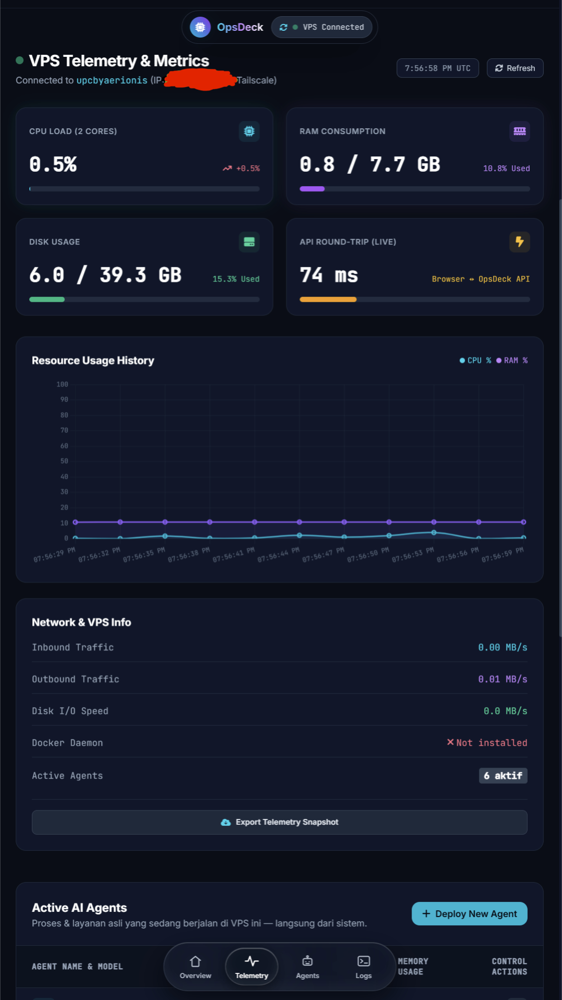
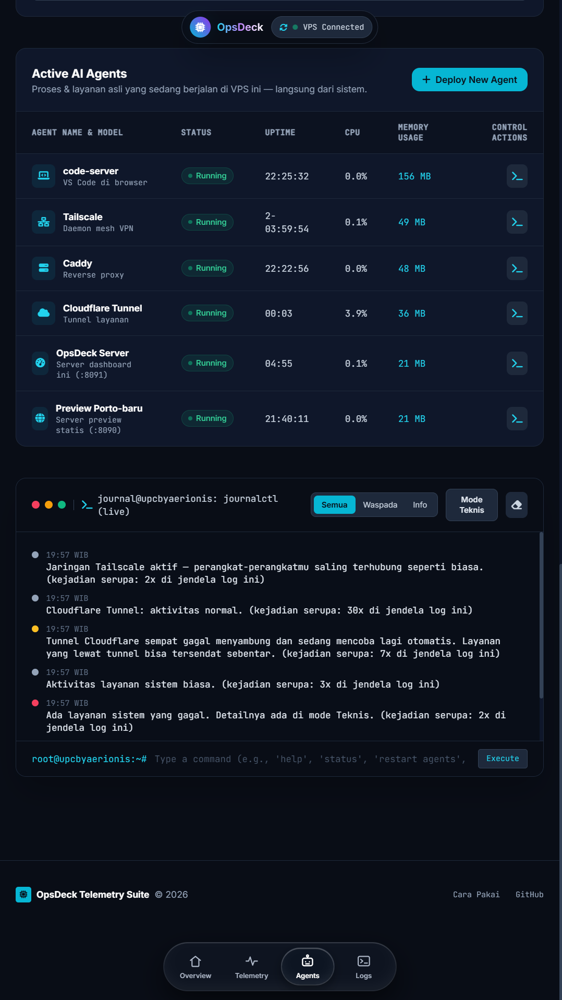

# OpsDeck

Dashboard web untuk memantau VPS dari satu layar: telemetri asli (CPU, RAM, disk, jaringan), daftar proses yang sedang berjalan, dan log sistem langsung dari journal — dalam dua mode tampilan, **Teknis** dan **Awam**.

Semua data yang tampil **dibaca langsung dari server** dan diperbarui otomatis. Tidak ada data simulasi.



## Fitur

- **Telemetri real-time** — CPU, RAM, disk, laju jaringan & disk I/O, dibaca dari `/proc` dan diperbarui tiap 3 detik, lengkap dengan grafik riwayat.
- **Daftar proses asli** — layanan yang benar-benar berjalan di server (code-server, Caddy, Tailscale, opencode saat build, dll) beserta uptime, CPU, dan memori.
- **Log dua mode** — Mode Teknis menampilkan journal mentah. Mode Awam menerjemahkannya menjadi kalimat sehari-hari berkode warna (baik / normal / waspada / gagal) memakai **aturan tetap di server — tanpa AI, tanpa token**.
- **Identitas dinamis** — nama server dan IP Tailscale diambil otomatis dari mesin; tidak ada alamat yang ditulis manual di HTML.
- **Khusus Tailscale** — server hanya mendengarkan di interface Tailscale, sehingga halaman ini tidak terbuka dari internet publik.
- **Halaman Cara Pakai** — panduan berbahasa awam di `panduan.html`.



## Menjalankan

Persyaratan: Linux dengan systemd (`journalctl`), Python 3 (hanya pustaka standar), dan Tailscale aktif.

```bash
python3 server.py
```

Server akan mendeteksi IP Tailscale mesin ini secara otomatis, lalu melayani dashboard di port `8091`. Buka dari perangkat mana pun yang tergabung di tailnet yang sama:

```
http://<ip-tailscale-server>:8091
```

## API

| Endpoint | Isi |
|---|---|
| `GET /api/stats` | Hostname, IP Tailscale, CPU, RAM, disk, laju jaringan & disk, load, uptime, status Docker |
| `GET /api/agents` | Grup proses yang berjalan beserta uptime, CPU, dan memori |
| `GET /api/logs` | 45 baris terakhir `journalctl` |
| `GET /api/feed` | Log yang sama, diterjemahkan aturan tetap menjadi kejadian berbahasa sehari-hari (untuk Mode Awam) |

## Keamanan

- Server **hanya** terikat (bind) ke alamat IP Tailscale — tidak mendengarkan di alamat publik maupun localhost.
- Nama server dan IP tidak ditulis di dalam HTML; keduanya datang dari API saat halaman dibuka.
- Repo ini tidak memuat kredensial apa pun. Tangkapan layar di `docs/screenshots/` sudah diperiksa: IP pada tangkapan layar telah disensor oleh pemiliknya.

## Struktur

```
.
├── server.py        # server HTTP + API (Python, pustaka standar saja)
├── index.html       # dashboard utama
├── panduan.html     # halaman Cara Pakai
└── docs/
    └── screenshots/ # tangkapan layar dashboard
```

## Teknologi

Python 3 (stdlib `http.server`), HTML + Tailwind CSS (CDN) + Chart.js, `journalctl`, Tailscale.
